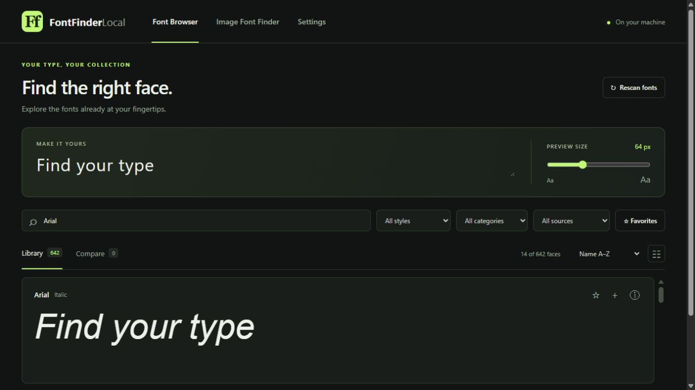
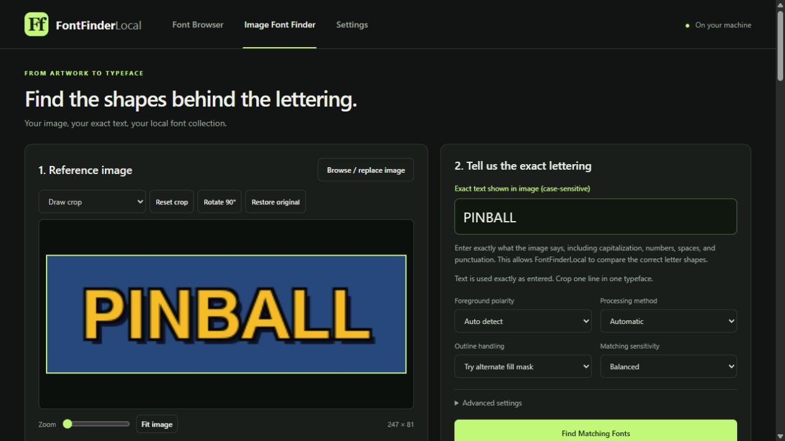
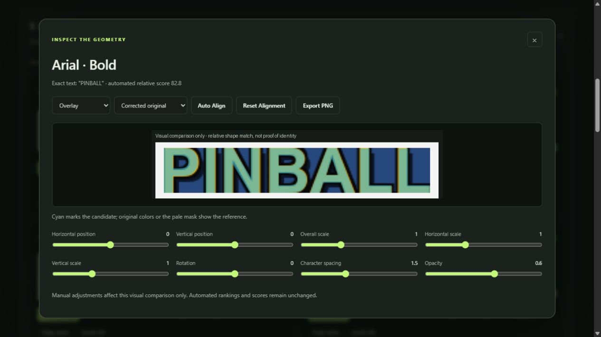

# FontFinderLocal

**Browse your fonts. Match lettering from an image. Keep everything on your computer.**

FontFinderLocal 1.0.0 is a portable Windows font browser and image font finder. It uses your installed fonts and custom font folders, runs locally in your web browser, and requires no account or internet connection during normal use.

## Font Browser

- Preview your own text with capitalization, punctuation, spaces and line breaks preserved.
- Search and filter by family, style, category, source, variable fonts and favorites.
- Adjust preview size, explore variable axes and named instances, and compare up to 12 faces.
- Browse installed fonts or custom folders without installing those fonts in Windows.
- Inspect metadata, Unicode coverage and file locations; rescan when your collection changes.
- Support for TTF, OTF, TTC/OTC, WOFF and WOFF2, with a virtualized library for large collections.



## Image Font Finder

1. Upload an image and crop it to one line in one typeface.
2. **Manually enter the exact, case-sensitive text in the image.**
3. Search your local collection and inspect the ranked candidates.
4. Compare using side-by-side, overlay, difference or outline views; adjust alignment and export a PNG.

**There is no OCR.** The supplied text is authoritative: case, punctuation, order, repeated characters and meaningful whitespace are preserved. No automatic recognition, spelling correction or case conversion occurs. You can change the text without uploading the image again.

Image tools include crop, zoom, pan, rotation, perspective correction, foreground selection and processed previews. Matching runs in the background and can be cancelled.





## Portable Windows download

Once the first release is published, download **FontFinderLocal-1.0.0-Windows-x64-portable.zip** from this repository's Releases page.

1. Extract the **entire ZIP** into a writable local folder.
2. Double-click **Start-FontFinderLocal.bat** or **FontFinderLocal.exe**.
3. Keep the console open while using the application in your browser.
4. Stop with **Stop-FontFinderLocal.bat** or Ctrl+C in the console. Closing the browser alone does not stop it.

No installer, administrator privileges, Python installation or Node.js installation is required. Keep `_internal` beside the EXE; the EXE alone is not the complete application. A current Edge, Chrome or Firefox browser is required. The launcher opens a loopback address, normally `http://127.0.0.1:8766`, and chooses another available port if necessary.

**Platform:** Windows x64. Validated on Windows 11 x64. Windows 10 x64 is an intended compatibility target but has not been independently validated; Windows 7/8, 32-bit Windows, ARM64, macOS and Linux are not supported release targets. A second clean Windows machine has not yet been tested. The executable is unsigned and Windows may display a publisher warning.

## Build and run from source

Install Python 3.13 x64, then open PowerShell in the repository folder:

```powershell
py -3.13 -m venv .venv
.\.venv\Scripts\python.exe -m pip install -r requirements-lock.txt
.\Start-FontFinderLocal.bat
```

Alternatively, double-click **Setup-FontFinderLocal.bat**, then **Start-FontFinderLocal.bat**. Internet access is needed to download dependencies during setup/build, not for normal use. Recreate the virtual environment when moving the source to another computer.

Build the portable Windows distribution:

```powershell
.\.venv\Scripts\python.exe -m pip install -r packaging/requirements-build.txt
.\.venv\Scripts\python.exe packaging/build_portable.py
```

The output is `dist/FontFinderLocal/` and a versioned ZIP with SHA-256 sidecar in `releases/`. The builder protects existing runtime data in the output folder. See [packaging instructions](packaging/README.md).

## Data and privacy

- Fonts, image processing and matching stay on your computer. There are no cloud services, analytics or CDN dependencies in the application.
- The server listens only on `127.0.0.1`; local Host/Origin checks and per-process request tokens protect mutation endpoints.
- Settings, favorites, font metadata, logs and temporary matching data live in `data/`, beside the portable EXE (or in the source root for source use).
- Fonts are read from their original locations. No proprietary fonts or personal data are supplied with the distribution.
- Keep your `data/` folder when moving your portable copy. Custom font-folder paths must exist on the destination machine. Uploaded-image workspaces are temporary, not a permanent image library.
- Custom folders can be added or removed in Settings. Removing a folder from the catalog does not delete its files.

`FONTFINDER_DATA_DIR` optionally selects a separate data directory. Use the same override when launching and stopping. Do not expose the server to a network or upload your data directory to GitHub.

## Limitations

- Matching finds similar shapes among fonts you have; it cannot find an absent font or prove a typeface's identity. Scores are relative similarities, not probabilities.
- Use one complete line in one typeface. Distortion, outlines, shadows, low contrast, cropping and custom lettering can reduce accuracy. Review the visual comparison.
- Missing glyphs and native rendering failures are excluded and counted. Browser rendering can still fall back for unsupported characters or font formats. Legacy `.fon`/`.fnt` fonts are not supported.
- Categories depend on font metadata; unknown categories remain unclassified. Distinct font files with the same name may appear separately.
- Rescan after changing fonts. Very large or malformed fonts can be slow; font parsing is not isolated in a sandboxed worker process.
- Variable-axis preview changes are session-only. Clipboard actions depend on browser permissions. Explorer integration is Windows-only.

## Tests and technical documentation

```powershell
.\.venv\Scripts\python.exe -m pytest -q --basetemp=test-results/pytest
node --test tests/test_preview_rows.mjs
```

Node.js is only needed for the JavaScript regression test. Tests generate their own font fixtures and do not redistribute Windows fonts. Full-catalog benchmarks depend on the tester's installed collection; prior measurements are retained as evidence, not promises for another machine.

- [Image Font Finder guide](docs/IMAGE_FONT_FINDER.md)
- [Architecture](docs/ARCHITECTURE.md) and [matching architecture](docs/MATCHING_ARCHITECTURE.md)
- [Accuracy measurements and limitations](STEP3_ACCURACY_REPORT.md)
- [Portable validation](STEP4_PROGRESS.md)
- [Version 1.0.0 release notes](docs/RELEASE_NOTES_v1.0.0.md)

## License

[MIT](LICENSE), copyright 2026 redbone labs. Bundled third-party components retain their own licenses, included in the portable package's `licenses/` directory. This license does not grant rights to any fonts you use with the application.
